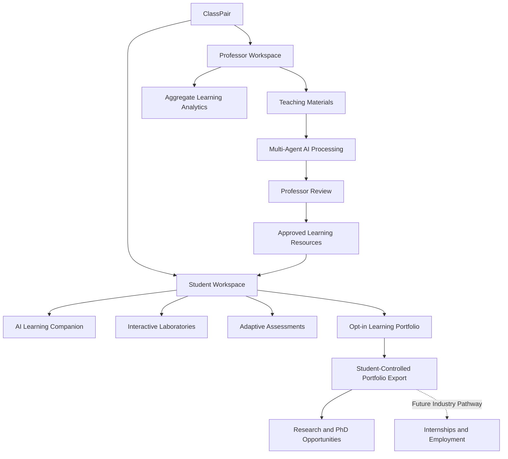

# ClassPair — AI-Powered Learning & Career Development

> Bridging the gap between education, research, and industry through Generative AI.

ClassPair is an AI-powered educational ecosystem developed collaboratively during the **Reply Student Tech Clash 2026 Hackathon**.

Our goal is to make university education more personalized, inclusive, interactive, and career-oriented by connecting students, professors, and potential industry partners through a unified learning ecosystem.

ClassPair combines personalized AI tutoring, interactive engineering laboratories, intelligent teaching assistance, adaptive assessments, and student-owned career portfolios.

---

## Our Vision

University education should go beyond classrooms and examinations.

ClassPair explores an ecosystem where:

- **Students** receive personalized learning support, develop practical skills, and build evidence of their academic and professional capabilities.
- **Professors** gain insights into classroom learning needs, generate educational resources, and discover potential research and PhD talent through voluntarily shared student portfolios.
- **Companies** could potentially discover emerging talent through student-shared portfolios that demonstrate relevant technical skills, projects, and academic progress.

Our long-term vision is to strengthen the connection between students, professors, and companies within university ecosystems such as Politecnico di Torino.

Industry integration remains a future development objective.

---

## Key Features

### Student Workspace

#### AI Learning Companion
- Course-specific AI tutoring powered by Google Gemini.
- Personalized explanations and guided learning.
- Visual concept maps.
- Evidence-based foundation checks.
- Private AI-assisted learning conversations.

#### Adaptive Assessment
- Subject-specific written practice.
- Adaptive three-turn oral examination simulations.
- Professor-configured examination formats and evaluation rubrics.
- Short audio submissions with on-demand transcription.

#### Interactive Engineering Laboratories
- Interactive code execution visualization.
- IoT breadboard simulator.
- Practical experimentation with engineering concepts.
- Visual and hands-on learning experiences.

#### Classroom Catch-Up
- Professor-approved classroom summaries.
- Structured code explanations.
- Text captions and visual concept maps.
- Educational resources generated from authorized classroom materials.

#### Accessible Learning Experience
- Focus mode.
- Comfortable text settings.
- Reduced motion.
- Automatic emphasis on important terminology.

Accessibility preferences are session-based and are not shared with professors.

#### Career & Research Trajectory
- Explicitly opt-in longitudinal learning portfolio.
- Editable academic, research, and activity records.
- Evidence of technical skills and learning progress.
- Student-controlled career and research portfolio export.
- Permanent deletion of portfolio data.

The portfolio is designed to help students voluntarily demonstrate their capabilities to:

- Professors and research supervisors for potential PhD and research opportunities.
- Companies for potential internships and employment opportunities.

Students retain control over whether and with whom their portfolio is shared.

---

### Professor Workspace

#### Intelligent Teaching Copilot
- AI-assisted educational resource generation.
- Course-specific syllabus configuration.
- Custom examination formats and evaluation rubrics.
- Authorized teaching material ingestion.
- Support for text, Markdown, and text-based PDF documents.

#### Multimodal Classroom Processing

Professors can provide:

- Classroom transcripts.
- Audio recordings.
- Whiteboard images.
- Written teaching materials.

These inputs can be processed on demand to generate structured educational resources.

#### Multi-Agent AI Architecture

ClassPair implements specialized AI agents for different educational tasks.

| AI Agent | Responsibility |
|---|---|
| Code Synchronizer | Organizes and explains classroom code |
| Visual Abstractor | Generates visual representations and concept maps |
| Catch-Up Agent | Produces structured summaries and text captions |
| Edge-Case Agent | Generates additional coding examples and edge cases |

The first three agents operate in parallel, while the Edge-Case Agent is available on demand.

#### Human-in-the-Loop Workflow

Professors review AI-generated educational resources and explicitly approve content before it is published to students.

#### Classroom Learning Analytics
- Aggregate topic-level learning insights.
- Identification of challenging academic concepts.
- Small-group suppression to reduce disclosure risks.
- Optional pseudonymous student contributions.

Professors do not have direct access to private student AI conversations.

#### Research Talent Discovery

Professors can manually review portfolios voluntarily submitted by students to better understand their academic interests, technical abilities, and potential suitability for future research opportunities.

No automated candidate ranking or selection is performed.

---

## How ClassPair Works



---

## Technology Stack

| Technology | Purpose |
|---|---|
| Python | Core application development |
| Streamlit | Interactive web interface |
| Google Gemini | Generative AI and multimodal processing |
| Google GenAI SDK | AI model integration |
| SQLite | Local data persistence |
| Pandas | Data processing and analytics |
| PyPDF | PDF document processing |
| Python-dotenv | Environment configuration |
| Pytest | Automated testing |

The prototype uses lightweight lexical retrieval for course-specific information rather than a vector database.

---

## AI Engineering Highlights

- Multi-agent orchestration.
- Parallel AI processing.
- Course-specific prompt engineering.
- Token-conscious prompt optimization.
- Multimodal AI integration.
- Adaptive assessment workflows.
- Human-in-the-loop content approval.
- Lightweight document retrieval.
- Role-based application workflows.
- Privacy-conscious data architecture.

---

## Getting Started

### Prerequisites

- Python 3.11 or 3.12
- Git
- Google Gemini API key

### 1. Clone the Repository

```bash
git clone https://github.com/Rahul360-cyber/uniai-ecosystem.git
cd uniai-ecosystem
```

### 2. Create a Virtual Environment

Windows PowerShell:

```powershell
py -3.11 -m venv .venv
.\.venv\Scripts\Activate.ps1
```

Linux / macOS:

```bash
python3.11 -m venv .venv
source .venv/bin/activate
```

### 3. Install Dependencies

```bash
python -m pip install --upgrade pip
python -m pip install -r requirements.txt
```

Streamlit is pinned to version `1.37.0`.

Python 3.11 or 3.12 is recommended for dependency compatibility.

### 4. Configure Environment Variables

Create a local `.env` file using `.env.example` as a reference.

If a `.env` file already exists, merge missing configuration values without overwriting existing secrets.

Configure:

- Google Gemini API key.
- Student demo account credentials.
- Professor demo account credentials.
- Feedback HMAC secret.

Generate a random secret using:

```bash
python -c "import secrets; print(secrets.token_hex(32))"
```

Use unique demo passwords of at least 12 characters.

Never commit API keys, passwords, or environment secrets to GitHub.

### 5. Run the Application

```bash
python -m streamlit run app.py
```

Open the application in your browser:

http://localhost:8501

Use your configured fictional student or professor account to explore the corresponding workspace.

---

## Testing

Install the testing dependency:

```bash
python -m pip install pytest
```

Run the test suite:

```bash
python -m pytest -q tests
```

---

## Deployment

ClassPair can be deployed using Streamlit Community Cloud.

Recommended configuration:

- Main application file: `app.py`
- Python version: 3.11 or 3.12
- Environment secrets configured through the deployment platform.

Do not upload local databases, private learning records, or credentials.

Recommended `.gitignore` entries:

```gitignore
.env
.env.*
!.env.example
.venv/
venv/
__pycache__/
.pytest_cache/
*.db
*.db-wal
*.db-shm
*.db-journal
.streamlit/secrets.toml
```

---

## Privacy & Responsible AI

ClassPair explores responsible, privacy-conscious AI-assisted education through the following design principles:

- Explicit consent for longitudinal learning portfolio tracking.
- Student-controlled data exports and deletion.
- Session-only accessibility preferences.
- Pseudonymous classroom feedback.
- Aggregate classroom analytics with small-group suppression.
- Human approval of educational content before publication.
- No automated official grading.
- No automated recruitment or PhD candidate ranking.
- No inference of neurodivergence, emotional state, or cognitive characteristics.

Students' private AI conversations are not directly accessible to professors.

Google Gemini is an external cloud AI service. Information submitted through its API leaves the application server. Demonstrations should therefore use fictional or appropriately authorized materials.

ClassPair is a hackathon prototype, not a production-ready university service or a certified GDPR/EU AI Act implementation.

---

## Current Limitations

The prototype currently demonstrates two fictional course environments:

- Computer Engineering
- Internet of Things (IoT)

The current implementation does not include:

- Continuous real-time classroom streaming.
- Automatic live speech-to-text captions.
- Real-time camera processing.
- Production-grade authentication and authorization.
- Advanced vector-based RAG infrastructure.
- Official automated academic grading.
- Direct employer integration.

Media processing and transcription are performed on demand.

---

## Future Roadmap

- Advanced Retrieval-Augmented Generation (RAG).
- Vector database integration.
- Expanded course and curriculum support.
- Real-time classroom assistance.
- Improved assessment personalization.
- Production-grade authentication and security.
- Accessibility evaluation and improvements.
- Consent-based academic and industry collaboration.
- Research and PhD opportunity discovery.
- Student-controlled career portfolio sharing with industry partners.

Future research and recruitment integrations would require appropriate institutional approval, governance, security measures, and human oversight.

---

## Hackathon

**Event:** Reply Student Tech Clash 2026

**Project:** ClassPair

**Category:** Generative AI, Education & Career Development

**Status:** Hackathon MVP / Proof of Concept

ClassPair was developed collaboratively to explore how artificial intelligence can support the next generation of university learning.

The project is independent and does not imply official endorsement or partnership with Politecnico di Torino.

---

## Team

ClassPair is the result of teamwork, collaboration, creative problem-solving, and a shared vision for the future of AI-powered education.

---

## Feedback

We welcome feedback on the concept, technical implementation, and potential future development of ClassPair.

---

### ClassPair

**Learn. Explore. Build. Connect.**

Empowering students today for the academic and professional opportunities of tomorrow.
